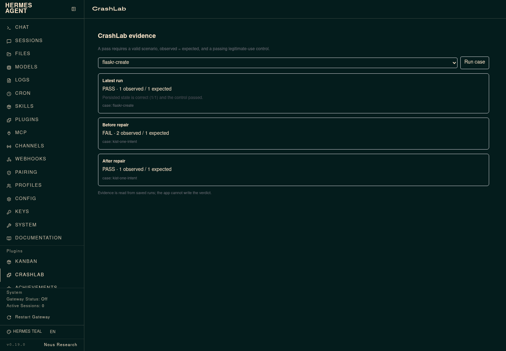

# CrashLab

## Isolated campaign integration

This copy adds registered campaign list/validate/run tools while retaining the
original four tools. See [CAMPAIGNS.md](CAMPAIGNS.md) for setup, safe target
configuration, verification and limitations. Inventory contention execution is
supported; mixed browser campaign execution is intentionally blocked pending
network confinement. The original project README follows below.

CrashLab is a Hermes plugin for reproducing and repairing a failure that normal
browser tests miss: the server commits a write, the response is lost, the user
retries, and the application ends up with two records for one intent.

It is deliberately narrow. One contract describes the journey, the fault, the
state probe and the expected result. The same contract must fail on the broken
application and pass on the repaired one. A control journey checks that the
repair did not simply block legitimate later purchases.

> CrashLab is a working vertical slice, not a finished testing product. The
> fixtures are small, deliberately buggy applications. It proves one failure
> class across two example applications; it does not discover arbitrary bugs or
> guarantee general autonomous repair.

## What is in the box

- `crashlab_validate` — validate a saved contract without running it.
- `crashlab_run` — run a contract and read persisted state through `/state`.
- `crashlab_compare` — run the same contract against a buggy and a repaired URL.
- `crashlab_list` — list bundled contracts.
- `crashlab_runner.js` — Playwright runner. It suppresses the response after the
  upstream server has processed the request, proves the write committed, then
  records screenshots and the persisted records.
- `contracts/checkout-lost-response.json` — checkout fixture.
- `contracts/booking-lost-response.json` — booking fixture.
- `server.py` and `booking.py` — the two deliberately buggy fixture apps.
- `desktop/plugin.js` — a native Hermes Desktop pane that displays the latest
  run, the comparison and campaign evidence through `ctx.rest`.
- `dashboard/plugin_api.py` — the pane's `/overview`, `/latest` and `/evidence`
  endpoints. `crashlab_run` persists `latest-run.json` for this view.

## Evidence from the development run

The checkout comparison produced:

- Buggy application: 2 persisted orders; expected 1; fail.
- Hermes-repaired application: 1 persisted order; expected 1; pass.
- Control: 2 distinct purchases; 2 orders; pass.

The booking fixture reproduced the same pattern:

- Buggy: 2 bookings; expected 1; fail.
- Fixed: 1 booking; expected 1; pass.
- Control: 2 distinct bookings; 2 bookings; pass.

See `DAY2.md`, `DAY3.md`, `DAY4.md` and `proof/README.md` for the runs, and `docs/repair-report.png` and `docs/booking-report.png` for the rendered evidence. The checked-in HTML/PNG evidence is
outside the plugin runtime; generated evidence is ignored by git.

## Install

Requirements:

- Hermes Agent v0.23 or newer.
- Node.js, `npm`, and Chromium available locally.
- `playwright-core` installed for the runner.

Fresh install from the public repository:

```bash
hermes plugins install dolepee/crashlab --enable
# When Hermes asks to install the Node sidecar, answer yes.
# If installed non-interactively, finish the sidecar once:
cd "$HERMES_HOME/plugins/crashlab" && npm ci
```

Then confirm:

```bash
hermes plugins validate "$HERMES_HOME/plugins/crashlab" --install-deps
hermes plugins doctor "$HERMES_HOME/plugins/crashlab"
```

The Desktop half is opt-in and appears in **Capabilities → Plugins**. It reads
`CRASHLAB_DATA_DIR` (default `~/.local/share/crashlab`) and scans the bundled
`contracts/` plus `CRASHLAB_CASE_DIR` (default `cases/`). Select a case and press
**Run case**; the run starts the app when the case has an `app.start` block and
persists `latest-run.json` for the pane. The same evidence is available from
`/crashlab`, `/crashlab runs` and `/crashlab run <case.json>` in a Hermes chat.

## Run a fixture

Start the buggy and repaired checkout servers:

```bash
PORT=8765 BUGGY=1 CRASHLAB_DB=data/orders-8765.db python3 server.py
PORT=8766 BUGGY=0 CRASHLAB_DB=data/orders-8766.db python3 server.py
```

Run the saved contract against each:

```bash
CHROME_PATH=/usr/bin/chromium node crashlab_runner.js contracts/checkout-lost-response.json
CHROME_PATH=/usr/bin/chromium node crashlab_runner.js contracts/checkout-lost-response.json --base-url http://127.0.0.1:8766
```

For the second fixture:

```bash
PORT=8785 BUGGY=1 CRASHLAB_DB=data/bookings-8785.db python3 booking.py
PORT=8786 BUGGY=0 CRASHLAB_DB=data/bookings-8786.db python3 booking.py
CHROME_PATH=/usr/bin/chromium node crashlab_runner.js contracts/booking-lost-response.json
CHROME_PATH=/usr/bin/chromium node crashlab_runner.js contracts/booking-lost-response.json --base-url http://127.0.0.1:8786
```

`BUGGY=0` is a prepared repaired fixture for comparison. The Day 3 gate is
different: a real Hermes agent edited the failing application and the unchanged
contract was rerun against that edit. `DAY3.md` records that run.

## Contract format

A contract has:

- `app.base_url` or `app.start` (command, cwd, Python, setup requests), and
  optional `app.reset_url`.
- `fault.route`, `fault.mode` and `fault.occurrence`.
- `journey` — browser steps such as `goto`, `click`, `text` and `screenshot`.
  Waits are declarative (`wait_for_fault`, `wait_for_count`, `wait_for_value`,
  `wait_for_any`); contracts do not execute JavaScript on the host or in the
  page.
- `state` — the expected length and the observer. `mode: "sqlite"` uses a
  read-only database probe outside the app; `mode: "http"` uses the app's
  `/state` endpoint and is not independent of the application under repair.
- `control` — a separate journey and state expectation used to catch an
  over-restrictive repair.

The runner exits non-zero when the primary or control assertion fails, or when
the configured fault did not match and commit a write. A failed check is
evidence, not a pass.

## Demo

`demo/crashlab-demo.mp4` is an 88-second terminal replay built from the real
buggy run, the Hermes repair summary and the repaired run. It is a replay, not
a live screen capture; the opening frame says so. The source is in
`demo/index.html`; `demo/record_demo.js` records it with Playwright.

`demo/kist-demo.mp4` is an 88-second replay of the external Kist run: the
unmodified before run, the frozen contract, the Hermes patch and the repaired
run. Its source is `demo/kist.html`; `demo/record_kist.js` records it.

`demo/crashlab-kist-live.mp4` is a 26.5-second **live browser recording**, not
an evidence replay. It shows the unmodified Kist checkout creating a second
goal after a dropped response, then the same intent against the Hermes-repaired
checkout creating one. The recorder is `external/kist/record_session.js`.

## External application example

The `external/kist` directory contains a browser contract against an
unmodified Kist checkout, the Hermes repair patch, before/after screenshots and
the exact replay command. It is an external adoption example, not a bundled
fixture. The contract checks one recovery intent against one goal and two
deliberate goals against two goals; the Kist database is observed directly.

The contract now carries an `app.start` block. `crashlab_run` starts Kist
through the same local-app path as every other case; `run_kist.py` builds that
block and no longer runs a separate application launcher.

`cases/checkout-local-start.json` and `cases/checkout-local-fixed.json` are the
fixture transfer check. `cases/flaskr-create.json` is the independent application
check against Pallets' Flaskr tutorial at commit
`49943b5a94413a530761350f04e896f76e8d620e`; it registers a user, creates one
post and observes one row in SQLite through the same `app.start` path. See
[external/flaskr/README.md](external/flaskr/README.md).

See [external/kist/README.md](external/kist/README.md). Do not describe the
before run as repaired or the patch as a general autonomous repair.



The image above is the actual Hermes dashboard tab, reading saved evidence. The
Desktop pane is a separate surface and needs a running Hermes Desktop session to
capture.

## Scope and limitations

- Two local fixtures plus the external Kist example; Kist is one app and one
  Hermes one-shot repair, not proof of broad compatibility.
- The second application check is Flaskr, a public tutorial app; the checkout
  cases remain bundled fixtures.
- The Desktop pane was launched in Hermes Desktop for the earlier evidence view
  in `docs/desktop-pane.png`; the newest run/comparison view is wired to the
  persisted run but has not been visually recaptured.
- The runner requires a local Chromium and `playwright-core`.
- The fault is a suppressed response after commit; this is not a general chaos
  testing engine. `mode: "http"` is app-supplied and cannot prove the app did not
  tamper with its own state; use `sqlite` for the bundled fixtures.
- The repair evidence covers Kist and the bundled checkout fixture. It is one
  known defect class, not a claim of general repair.
- `app.start` runs a local command by design. It receives only PATH, LANG, TZ,
  HOME, PORT and contract-declared environment values; it does not inherit the
  agent's provider or API credentials.

## Disclosure

CrashLab starts local fixture servers, launches headless Chromium, writes
SQLite data and screenshots under `data/` and `evidence/`, and reads the saved
evidence file through the Desktop backend. It makes no network calls to third
parties and stores no credentials.
