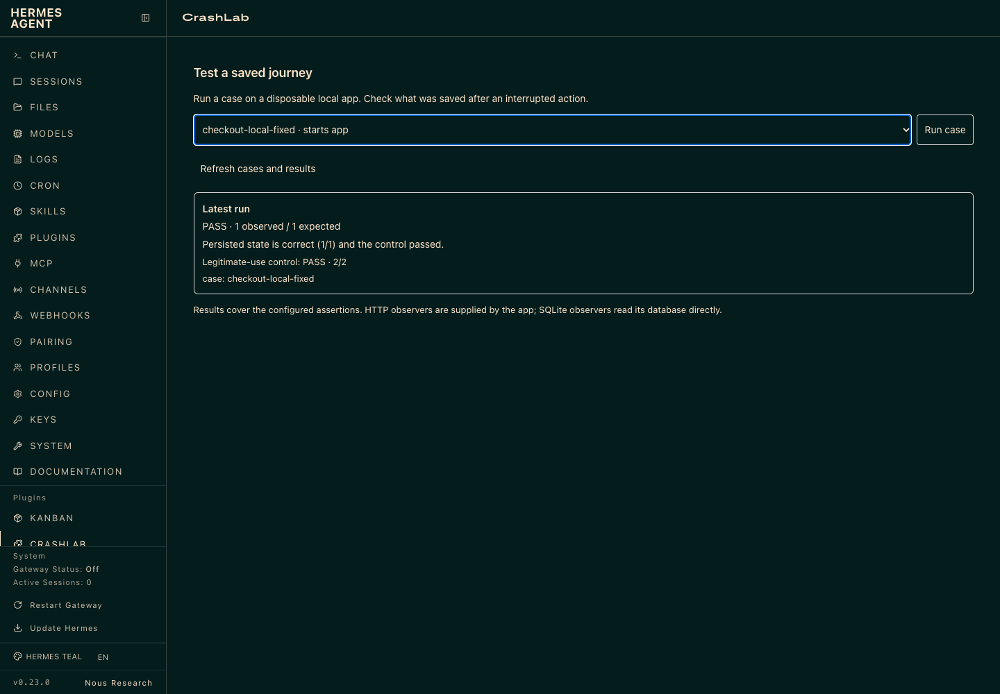

# CrashLab

CrashLab is a Hermes plugin that checks what an application saved after a
response was lost. A browser can show an error even after the server committed:
retrying may create a duplicate record. CrashLab reproduces that interruption,
reads the persisted state, and verifies the repair against the same case.

A legitimate-use control checks that fixing a retry still allows two deliberate
operations. The comparison freezes the contract and checks evaluator identity
across the before/after runs. Results cover the configured assertions, not every
possible application failure.

## A reproduced external repair

On November 7, 2026, a fresh Hermes 0.23 session used CrashLab on the unmodified
[Kist Finance](https://github.com/grzella/kist-finance) savings-goal application,
then wrote a repair in a separate checkout:

- Before: retrying one interrupted create saved **two goals**, expected one.
- After: the same saved case produced **one goal**, and the control still
  created **two deliberate goals**, including identical values.
- A separate Hermes registry comparison reproduced both results using one frozen
  contract. The evaluator and the agent's case remained unchanged.

The [patch, selected tool events, screenshots and replay summary](external/kist/README.md)
are included. This is one measured application repair, not a general autonomous
repair claim. Kist goals are savings records, not payments or money movement.

A separate [Flaskr guided repair](external/flaskr/README.md) starts from a project
and intended behavior, with Hermes constructing its own case. It reproduced a
native POST retry duplicate, repaired it, and verified the same experiment.
The record distinguishes the successful acceptance from a prior failed trial
that exposed a navigation race, and states the fresh-database limitation.

## Use it in Hermes

After installation, tell Hermes where your disposable local Git app lives and
what behavior you expect. For example:

> Check the app at /path/to/my-app. Retrying one submission after its response
> is lost should save one record; two deliberate submissions must remain allowed.

The bundled skill guides app inspection and case preparation. Review the intended
behavior and assertions, reproduce a failure, repair the application, then rerun
the same experiment ID. The dashboard shows whether that evidence is current and
lets you rerun the case or enable completion reminders.

A passing fault case must exercise recovery. The default `recovery.mode: "retry"`
requires a successful repeated write after interruption, using the original
method, URL and complete request payload (JSON object key order is ignored).
A changed intent token is rejected even when the database mapping omits that key. Changing Retry to display a local success message fails.
Redirecting native POSTs remain supported.

For an application that recovers by reading back its result, declare
`recovery.mode: "reconcile"`, a GET `route`, the original `initial_field` and
readback `query_parameter`, plus `response_id_path` and `record_id_field`.
The captured successful response must match both the original intent and the
independently observed record ID. A query for an unrelated intent or a wrong ID
fails. Results include the measured request sequence and recovery decision;
these are configured behavior checks, not a security boundary against the app.

For a bundled first run, use `cases/checkout-local.json` to see the duplicate and
`cases/checkout-local-fixed.json` to see the passing implementation. These cases
start disposable local fixture apps automatically.

For your own app, configure its launch command or loopback URL, browser journey,
write endpoint and state assertion. SQLite observers read the database directly;
HTTP observers trust the state returned by the app. JSON request-field mappings
can bind stored rows to the submitted intent and payload. See the external Kist
example for a real application and the contract notes below for the supported
surface.

## Follow a repair experiment

Tell Hermes the path to a disposable local Git application and the behavior you
expect. The bundled CrashLab skill guides app inspection and case construction.
Hermes calls `crashlab_prepare` with the app path, intended behavior and case
object; it stores the frozen case outside the editable app. Review the proposed
assertions before relying on them. Setup still requires the application's own
runtime and dependencies; this does not discover arbitrary application semantics.

Call `crashlab_experiment_run` with the returned experiment ID. A valid failing
run establishes `REPRODUCED`. After editing the app, rerun that ID: `VERIFIED`
requires a changed source fingerprint, a passing frozen case and a passing
legitimate-use control. An initial pass is `PASS_WITHOUT_REPAIR_PROOF`.
`crashlab_experiment_status` marks evidence `STALE` after project edits.

Freshness covers Git-tracked and nonignored untracked files, including deletions,
up to 5000 files / 100 MB. Ignored files, installed dependencies and runtime
configuration are outside this check. Symlinks and non-Git roots are unsupported.
These hashes detect drift in a trusted local workflow; they are not a security
boundary against an application or agent with the same filesystem privileges.

## Test an operation across recovery boundaries

Set `recovery_campaign` to `["before_delivery", "after_commit", "restart_after_commit"]`
in the prepared case. The same operation, stored-field assertions and deliberate-use
control run at each boundary:

| Boundary | Validity requirement | Recovery requirement |
| --- | --- | --- |
| Before delivery | The intercepted request is never forwarded; the scoped state remains empty | A real successful retry creates the intended record |
| After commit | A successful upstream response and an observed committed write precede the lost acknowledgement | The original-intent retry leaves the intended result |
| Restart after commit | The owned process stops and restarts on the same port/data directory; observed records survive | Recovery still works after process memory is lost |

Include one `wait_for_fault` step before retry. The restart variant inserts a
managed `restart_app` at that boundary. It does **not** replay initialization,
setup requests or reset. The startup command must preserve existing data; a
startup that erases the observed records is an error, not a passing fresh run.
Each boundary uses a separate disposable initial app; only the restart inside
the third boundary retains that scenario's database. This is one operation's
recovery campaign, not three unrelated bug classes or statistical flakiness proof.

`cases/checkout-recovery.json` demonstrates the buggy fixture;
`cases/checkout-recovery-fixed.json` demonstrates durable protection. They are
explicit fixtures, not discovered external defects. To construct the same
campaign for the documented Kist application, add `--recovery-campaign` to
`external/kist/run_kist.py`.

### Understand and reuse the result

Choose **Inspect evidence** on an experiment. The report separates current source
freshness from a selected historical run and shows each measured boundary:
requests and intent/payload, interruption, independently observed records, actual
restart lifecycle, recovery decision and legitimate-use control. Missing historical
events are labeled absent rather than reconstructed. The source section contains
an actual bounded Git diff against that run's HEAD; it may include pre-existing
changes and does not include untracked file contents.

Use **Export regression** or `crashlab_experiment_export` to retain the test after
the conversation. The bundle stores frozen behavior and a launch template with
separate hashes. Local project/interpreter bindings live outside those assertions. Portable interpreter binding currently supports direct Python argv launches, including explicit Python executable paths; wrapper or other-runtime launches are rejected instead of silently ignoring the chosen interpreter.
It includes declared setup/environment values and can contain application data;
review it before sharing. It does not package dependencies, source repair, records
or a transferable VERIFIED status.

A fresh session can use `crashlab_experiment_import` with the bundle, disposable
`project_path` and absolute executable `app_python`. The evaluator must match;
otherwise install the recorded source pin or explicitly prepare a new experiment.
The import starts PREPARED. Reproduce the original failure, apply the repair to the
app, and rerun to earn new evidence. Binding paths does not rewrite journey steps,
record assertions or expected counts.

The same path is available without a model, from the installed plugin directory:

```bash
python crashlab_replay.py export --experiment EXPERIMENT_ID
# Copy the returned bindings.example.json and set project_path / app_python.
python crashlab_replay.py import --bundle /path/to/regression.json --bindings /path/to/bindings.json
python crashlab_replay.py run --experiment NEW_EXPERIMENT_ID
python crashlab_replay.py report --experiment NEW_EXPERIMENT_ID
```

Use the same `CRASHLAB_DATA_DIR` when accessing an existing experiment. A measured
failing baseline returns a nonzero exit code as expected. Application runtimes,
dependencies and any external absolute launch paths remain your responsibility.

The dashboard shows your five most recent repair experiments and all watched
experiments, their current
source status, the last measured outcome and control. Use **Rerun frozen case**
after edits and **Watch edits** for completion reminders. Status refreshes when
you return to the browser tab or window or press **Refresh cases and results**.

Call `crashlab_experiment_watch` with the ID and `enabled: true` to request a
completion reminder while working on that project. After matching absolute-path
edits, the Hermes `pre_verify` hook requests current verification when evidence
is stale, failed or unavailable. Hermes caps continuation nudges; this is a
reminder, not an execution barrier. Set `enabled: false` to stop watching, even
if the frozen experiment has become invalid. Other projects are unaffected.

## Included tools

- `crashlab_prepare`: freeze an app-specific repair experiment.
- `crashlab_experiment_run`: reproduce or verify the same experiment.
- `crashlab_experiment_status`: check current source freshness.
- `crashlab_experiment_watch`: request project-scoped completion reminders.
- `crashlab_experiment_report`: inspect one recorded run and its real evidence.
- `crashlab_experiment_export`: save frozen behavior and a portable launch template.
- `crashlab_experiment_import`: bind that template to a fresh local checkout.
- `crashlab_validate`: validate a case without running it.
- `crashlab_run`: execute a saved browser case and persist its result.
- `crashlab_compare`: run one frozen case against broken and repaired URLs.
- `crashlab_list`: list bundled contracts.
- Campaign list/validate/run tools: an optional, separate inventory-contention
  experiment. See [CAMPAIGNS.md](CAMPAIGNS.md); mixed browser campaigns remain
  validation-only pending network confinement.

The checkout and booking apps are deliberately buggy fixtures. Historical
fixture reports remain in `proof/` and the day-by-day development notes; they
should not be confused with the external Kist application.

## Install

Requirements:

- Hermes Agent v0.23 or newer.
- Node.js, `npm`, and Chromium available locally.
- `playwright-core` installed for the runner.

Fresh install from the public repository:

```bash
hermes plugins install dolepee/crashlab --enable
# When Hermes asks to install the Node sidecar, answer yes.
# If installed non-interactively, finish the sidecar once:
cd "${HERMES_HOME:-$HOME/.hermes}/plugins/crashlab" && npm ci
# If no system Chromium/Chrome is available:
npx playwright-core install chromium
```

Then confirm:

```bash
hermes plugins validate "${HERMES_HOME:-$HOME/.hermes}/plugins/crashlab" --install-deps
hermes plugins doctor "${HERMES_HOME:-$HOME/.hermes}/plugins/crashlab"
```

The Desktop half is opt-in and appears in **Capabilities → Plugins**. It reads
`CRASHLAB_DATA_DIR` (default `~/.local/share/crashlab`) and scans the bundled
`contracts/` plus `CRASHLAB_CASE_DIR` (default `cases/`). Select a case and press
**Run case**; the run starts the app when the case has an `app.start` block and
persists `latest-run.json` for the pane. Historical measured evidence is available from
`/crashlab`, `/crashlab runs` and `/crashlab run <case.json>` in a Hermes chat.
Quote paths containing spaces: `/crashlab run "/my project/case.json"`.
`crashlab_list` includes self-starting cases and setup requirements. A template
marked `setup_required` reports its instructions before launching anything;
remove that field after configuring the external application. Setup errors are
saved as `ERROR`, separately from measured assertion failures (`FAIL`).

## Run a fixture

Start the buggy and repaired checkout servers:

```bash
PORT=8765 BUGGY=1 CRASHLAB_DB=data/orders-8765.db python3 server.py
PORT=8766 BUGGY=0 CRASHLAB_DB=data/orders-8766.db python3 server.py
```

Run the saved contract against each:

```bash
CHROME_PATH=/usr/bin/chromium node crashlab_runner.js contracts/checkout-lost-response.json
CHROME_PATH=/usr/bin/chromium node crashlab_runner.js contracts/checkout-lost-response.json --base-url http://127.0.0.1:8766
```

For the second fixture:

```bash
PORT=8785 BUGGY=1 CRASHLAB_DB=data/bookings-8785.db python3 booking.py
PORT=8786 BUGGY=0 CRASHLAB_DB=data/bookings-8786.db python3 booking.py
CHROME_PATH=/usr/bin/chromium node crashlab_runner.js contracts/booking-lost-response.json
CHROME_PATH=/usr/bin/chromium node crashlab_runner.js contracts/booking-lost-response.json --base-url http://127.0.0.1:8786
```

`BUGGY=0` is a prepared repaired fixture for comparison. The Day 3 gate is
different: a real Hermes agent edited the failing application and the unchanged
contract was rerun against that edit. `DAY3.md` records that run.

## Contract format

A contract has:

- `app.base_url` or `app.start` (command, cwd, Python, setup requests), and
  optional `app.reset_url`.
- `fault.route`, `fault.mode` and `fault.occurrence`.
- `journey` — browser steps such as `goto`, `click`, `text` and `screenshot`.
  Waits are declarative (`wait_for_fault`, `wait_for_count`, `wait_for_value`,
  `wait_for_any`); contracts do not execute JavaScript on the host or in the
  page.
- `state` — the expected length and the observer. `mode: "sqlite"` uses a
  read-only database probe outside the app; `mode: "http"` uses the app's
  `/state` endpoint and is not independent of the application under repair.
- `control` — a separate journey and state expectation used to catch an
  over-restrictive repair.

The runner exits non-zero when the primary or control assertion fails, or when
the configured fault did not match and commit a write. A failed check is
evidence, not a pass.

## Historical recordings

`demo/kist-demo.mp4` is an earlier evidence replay and
`demo/crashlab-kist-live.mp4` is an earlier browser recording. They concern the
historical repair, not the fresh November 7 patch, and are not final submission
videos. Recording plans and source are maintained privately.

## External application example

The `external/kist` directory contains a browser contract against an
unmodified Kist checkout, the Hermes repair patch, before/after screenshots and
the exact replay command. It is an external application verification example, not evidence of user
adoption. The contract checks one recovery intent against one goal and two
deliberate goals against two goals; the Kist database is observed directly.

The contract now carries an `app.start` block. `crashlab_run` starts Kist
through the same local-app path as every other case; `run_kist.py` builds that
block and no longer runs a separate application launcher.

`cases/checkout-local.json` and `cases/checkout-local-fixed.json` are the
fixture transfer check. `cases/flaskr-create.json` is the independent application
check against Pallets' Flaskr tutorial at commit
`49943b5a94413a530761350f04e896f76e8d620e`; it registers a user, creates one
post and observes one row in SQLite through the same `app.start` path. See
[external/flaskr/README.md](external/flaskr/README.md).

See [external/kist/README.md](external/kist/README.md). Do not describe the
before run as repaired or the patch as a general autonomous repair.



The image above is the actual Hermes dashboard tab, reading saved evidence. The
Desktop pane is a separate surface and needs a running Hermes Desktop session to
capture.

## Scope and limitations

- Two local fixtures plus the external Kist example; Kist is one external app
  with a measured retry-failure repair, not proof of broad compatibility.
- Flaskr is a public tutorial app with a guided native-form repair and a separate
  historical passing workflow. Its retained repair covers fresh databases and
  needs migration work for existing installations. The checkout cases are fixtures.
- The Desktop pane was launched in Hermes Desktop for the earlier evidence view
  in `docs/desktop-pane.png`; the newest run/comparison view is wired to the
  persisted run but has not been visually recaptured.
- The runner requires a local Chromium and `playwright-core`.
- Recovery covers prevented delivery, lost acknowledgement after commit and a
  managed restart retaining observed state; this is not a general chaos testing
  engine. `mode: "http"` is app-supplied and cannot prove the app did not
  tamper with its own state; use `sqlite` for the bundled fixtures.
- The repair evidence covers Kist, Flaskr and the bundled checkout fixture. It is one
  known defect class, not a claim of general repair.
- `app.start` runs a local command by design. It receives only PATH, LANG, TZ,
  HOME, PORT and contract-declared environment values; it does not inherit the
  agent's provider or API credentials.

## Disclosure

CrashLab starts configured local applications, launches headless Chrome/Chromium,
and reads their state. Run summaries are stored under `CRASHLAB_DATA_DIR`
(default `~/.local/share/crashlab`); launched apps use temporary data directories,
and screenshot locations come from the case. These files can contain application
data. CrashLab needs no hosted testing service, but the configured application
and browser journey can make network requests. Use trusted disposable apps and
cases; the browser runner is not a network-confinement boundary.

## Browser verification guarantees

Fault cases require an empty independently observed scoped baseline. A dirty
baseline is INVALID, not a passing repair. `record_fields` checks exact stored
values; `request_fields` maps database columns to top-level JSON request fields
on the fault route, binding every observed row to a distinct captured request.
Checkout cases check both the intent key and item. These checks are configured
per application; cardinality alone does not establish full business correctness.

Comparisons snapshot the contract once, use it for both runs, record its SHA-256
and evaluator hashes, and reject evaluator changes during the pair. These are
integrity checks in a trusted local installation, not an operating-system sandbox.

Install a browser with `npx playwright-core install chromium`, or set
`CHROME_PATH` to an existing Chromium/Chrome executable. Run real-browser
regressions with `CRASHLAB_BROWSER_TESTS=1 python -m unittest test_browser_integrity`.

For development checks, install `requirements-test.txt` to enable the JSON Schema
contract checks, then run `python -m unittest discover`. Real-browser acceptance
requires the Node sidecar and `CRASHLAB_BROWSER_TESTS=1`. Runtime plugin tools do
not require the test-only schema package. Completion reminders log experiment ID,
session ID and current state through the Hermes diagnostic logger.

Frozen experiments retain their evaluator identity. Updating the evaluator can
make an earlier experiment unavailable; preserve its historical evidence and
prepare a new experiment for the new version rather than editing frozen hashes.
